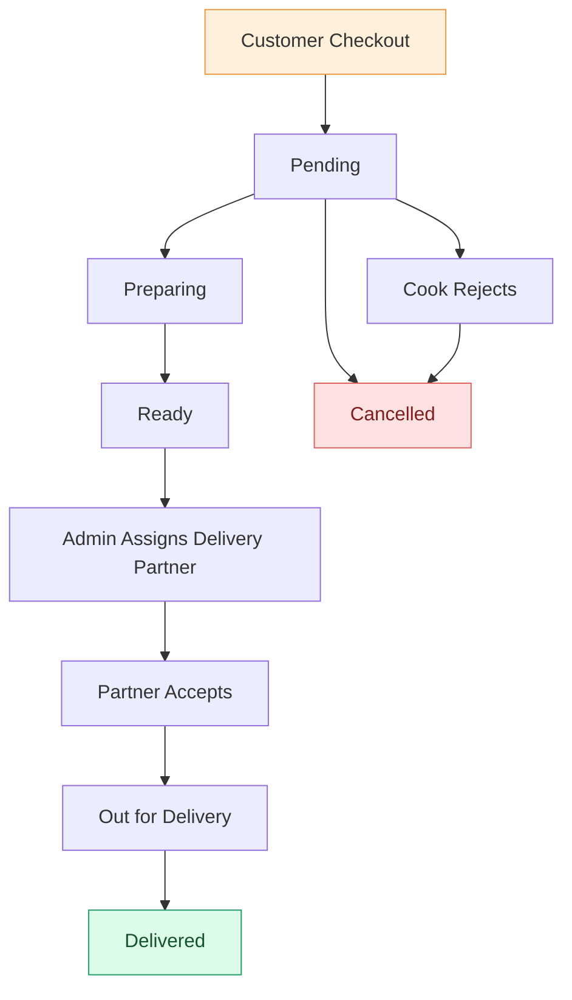
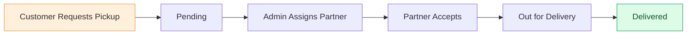

<div align="center">

#  DailyDibba

### Homemade Food. Local Cooks. A Taste of Home.

A community-driven food delivery platform connecting people living
away from home with trusted home cooks in their neighbourhood.

<br/>


<br/><br/>

**Built with ❤️ by Dhruvi Patel**

</div>

---

##  Overview

Moving to a new city for education or work often means leaving behind the comfort of home-cooked meals.

**DailyDibba** aims to bridge that gap.

It is a full-stack food delivery platform that connects students and working professionals with trusted neighbourhood home cooks (locally known as *aunties*).

Unlike conventional food delivery applications, DailyDibba focuses on affordable, hygienic, homemade food prepared by local cooks. It also introduces a digital Dabbawala experience, allowing users to request home pick-ups through delivery partners.

The platform consists of four interconnected modules:

| Module | Description |
|---|---|
| 🛒 Customer | Discover, order and review homemade food |
| 👩‍🍳 Cook | Manage kitchens, menus and incoming orders |
| 🛵 Delivery Partner | Handle assigned pickups and deliveries |
| 🛡️ Admin | Manage users, cooks, orders and operations |

---

##  Features

###  Customer Experience

Discover homemade food and enjoy a seamless ordering experience.

- **Authentication:** Secure signup and login.
- **Explore Dibbas:** Browse dishes by category.
- **Nearby Cooks:** Discover cooks using filters for cuisine, food type, price and distance.
- **Kitchen Profiles:** View menus, ratings and customer reviews.
- **Flexible Tiffin Sizes:** Choose Small, Regular or Large portions.
- **Cart & Wishlist:** Manage favourite dishes and shopping selections.
- **Smart Checkout:** Cash on delivery or online payment option (mock payment currently).
- **Multi-Cook Orders:** Automatically creates separate orders for each cook at checkout.
- **Home Pick-Up:** Request a delivery partner to collect a tiffin from your home.
- **Order Management:** Track order status, view order history and cancel pending orders.
- **Reviews & Ratings:** Rate cooks after successful delivery.
- **Notifications:** Receive updates whenever an order status changes.

###  Cook Dashboard

Everything a home cook needs to manage their kitchen.

- Create and manage kitchen profiles.
- Toggle kitchen availability (Open / Closed).
- Maintain a daily menu with dish images.
- Categorise food into Gujarati, Punjabi, South Indian, Jain and Diet Food.
- Set dish prices, quantities and descriptions.
- Manage incoming orders.
- Update order status: Pending → Preparing → Ready.
- Reject incoming orders.
- View previous orders and earnings.

###  Delivery Partner Dashboard

A dedicated interface for managing deliveries efficiently.

- Receive delivery assignment offers from the admin.
- Accept or decline assignments.
- Separate Pickups and Deliveries sections.
- Update order status after pickup and successful delivery.
- Toggle delivery availability.

###  Admin Dashboard

Centralised control over the entire platform.

- Dashboard analytics for orders, revenue and users.
- Review and approve new home cooks.
- Manage all customer and cook accounts.
- View and manage platform orders.
- Assign delivery partners to orders.
- Override order statuses when required.
- Enable or disable user accounts.

---

## 🔄 How DailyDibba Works

### Order Lifecycle



### Home Pick-Up Lifecycle



### ⚙️ Behind the Scenes

DailyDibba incorporates several important backend mechanisms:

- **Independent Cook Orders:** A cart containing dishes from multiple cooks is split into separate orders, each with its own delivery lifecycle.
- **Transactional Stock Management:** Stock is reserved during checkout using database transactions and row-level locks, preventing overselling.
- **Automatic Stock Restoration:** Cancelled orders restore their reserved quantities.
- **Centralised Order Management:** All status changes pass through a common service with role-based transition rules.
- **Role-Based Access Control:** Customers, cooks, delivery partners and admins have access only to their permitted operations.

---

## 🧰 Tech Stack

Built using a modern JavaScript stack with PostgreSQL for reliable data management.

| Layer | Technologies |
|---|---|
| Frontend | React.js, Vite |
| Routing | React Router |
| State Management | Context API |
| Backend | Node.js, Express 5 |
| Database | PostgreSQL (NeonDB) |
| Database Access | Raw SQL using `pg` |
| Authentication | JWT, bcrypt |
| Authorization | Role-Based Access Control (RBAC) |
| Validation | Zod |
| Security | Helmet, CORS allow-list, Rate Limiting |
| File Uploads | Multer (JPG, PNG, WebP – 3 MB limit) |

---

## 🏗️ Project Architecture

```text
DailyDibba/
│
├── frontend/
│   └── src/
│       ├── api/              # API client and service modules
│       ├── components/       # Reusable UI components
│       ├── context/          # Global state management
│       └── pages/            # Customer, Cook, Delivery & Admin pages
│
├── backend/
│   ├── db/
│   │   └── schema.sql        # Database schema
│   │
│   ├── scripts/              # Migration and seed scripts
│   │
│   └── src/
│       ├── middleware/       # Authentication, RBAC & validation
│       ├── routes/           # REST API routes
│       ├── services/         # Business logic and notifications
│       └── schemas.js        # Zod validation schemas
│
└── README.md
```

---

## 🚀 Getting Started

Follow these steps to run DailyDibba locally.

### Prerequisites

Make sure you have the following installed:

- [Node.js 20+](https://nodejs.org/)
- npm
- A PostgreSQL database ([NeonDB](https://neon.tech/) recommended)

### 1. Clone the Repository

```bash
git clone https://github.com/dhruvipatel49/DailyDibba.git

cd DailyDibba
```

### 2. Backend Setup

```bash
cd backend

npm install

cp .env.example .env
```

Configure your `backend/.env` file:

```env
DATABASE_URL=your_postgresql_connection_string
JWT_SECRET=your_long_random_secret
CLIENT_ORIGIN=http://localhost:5173

DELIVERY_FEE=40
PICKUP_FEE=50

ADMIN_EMAIL=admin@example.com
ADMIN_PASSWORD=your_admin_password
```

> **Note:** For NeonDB, include `?sslmode=require` in your database connection string.

Run database migrations and seed demo data:

```bash
npm run migrate
npm run seed
npm run dev
```

Backend API will be available at:

`http://localhost:5000`

### 3. Frontend Setup

Open another terminal:

```bash
cd frontend

npm install

echo "VITE_API_URL=http://localhost:5000" > .env

npm run dev
```

Frontend will be available at:

`http://localhost:5173`

---

## 🧪 Demo Accounts

The seed script creates demo accounts to help you explore the platform.

**Default password for all demo accounts:** `Password@123`

| Role | Email |
|---|---|
| 🛒 Customer | `customer@dailydibba.local` |
| 👩‍🍳 Cook | `premila@dailydibba.local` |
| 🛵 Delivery Partner | `rider@dailydibba.local` |
| 🛡️ Admin | Uses `ADMIN_EMAIL` and `ADMIN_PASSWORD` from `.env` |

### Try a Complete Order

1. Log in as a customer and place an order.
2. Log in as a cook and mark the order as Preparing, then Ready.
3. Log in as admin and assign a delivery partner.
4. Log in as the delivery partner and accept the assignment.
5. Mark the order as Picked Up and Delivered.
6. Return to the customer account and rate the cook.

> ⚠️ These credentials are strictly for local development. Change or remove demo accounts before deploying publicly. `npm run seed:reset` wipes all seeded data.

---

## 📡 API Overview

DailyDibba exposes a REST API under the `/api` base path.

All protected endpoints use JWT authentication:

```http
Authorization: Bearer <token>
```

| Module | Base Route |
|---|---|
| Authentication | `/api/auth` |
| Cooks & Menu | `/api/cooks`, `/api/menu` |
| Cart & Wishlist | `/api/cart`, `/api/wishlist` |
| Orders & Pick-ups | `/api/orders` |
| Cook Operations | `/api/cook` |
| Delivery Operations | `/api/delivery` |
| Admin Operations | `/api/admin` |
| Notifications & Uploads | `/api/notifications`, `/api/uploads` |

For complete endpoint documentation, request formats and response details, refer to [`backend/README.md`](backend/README.md).

---

## 🗺️ Roadmap

DailyDibba is designed to grow beyond a conventional tiffin delivery platform.

- [ ] 🤖 **AI-Based Recommendations** – Suggest dishes and cooks based on order history and food preferences.
- [ ] 💳 **Real Payment Integration** – Integrate Razorpay or Stripe.
- [ ] 🎟️ **Promo Codes** – Introduce discounts and promotional offers.
- [ ] 📍 **Real-Time Tracking** – Replace polling with WebSockets for live order updates.
- [ ] ☁️ **Cloud Image Storage** – Move dish image uploads to cloud storage.
- [ ] 📱 **Mobile Application** – Bring DailyDibba to Android and iOS.

---

## 👩‍💻 Author

**Dhruvi Patel**

B.Tech Computer Engineering  
Pandit Deendayal Energy University (PDEU), Gandhinagar

---

<p align="center">
  Made with ❤️ to bring the comfort of home-cooked food closer to everyone.
</p>

<p align="center">
  ⭐ If you like this project, consider giving the repository a star!
</p>
